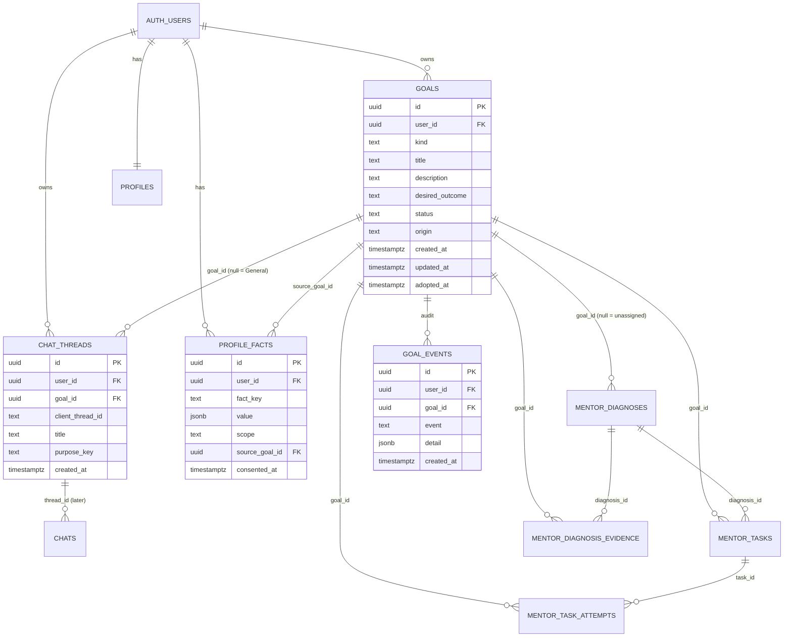

# 21 — Phase 4 proposal: persistent goals architecture

Read-only planning. No source file, migration or Supabase object was changed. Nothing was committed, pushed or deployed. The Cloudflare Worker spend ledger is untouched. Inspected checkout: branch `claude/practice-progress-journey` at `2739940` (Phase 3).

## Plain-English summary
There is no goals table, and no database schema is stored in this repository. What exists today is one flat set of per-account data: a `chats` table with no thread column, one `profiles` row full of CAT columns, four `mentor_*` tables, and a lot of memory that lives only in the browser. Marg builds every model prompt in the browser, from about a dozen memory sources that are scoped to the account and never to a goal. So "Goal A must not leak into Goal B" is mainly a **browser-side prompt-assembly problem**, backed by database columns that make the boundary explicit and queryable.

The proposal adds one `goals` table, a small thread registry, and a nullable `goal_id` on the existing mentor tables. Everything is additive and nullable, so old clients and every existing CAT user keep working unchanged. Existing CAT users see their temporary workspace exactly as today, with a **preview and an explicit "Save as a goal"** step. New users create their first goal themselves. Nothing is created automatically.

**What I could not inspect:** the real Supabase schema, RLS policies and constraints. They are not in the repo, and I was told not to touch Supabase. Every table shape below is inferred from the code that reads and writes it. Prerequisite P0 is to export the real definitions before anything is built.

## 0. Revision 2: founder decisions (approved) and what they change
Direction approved with decisions D1–D6 and ten extra requirements. **Where this section conflicts with a later section, this section wins.** The P0 checklist is in `reviews/22-phase4-p0-checklist.md`. Nothing is built; P4.1 waits for explicit approval.

### D1 — Staging project (mandatory)
- **Finding:** the repo holds no staging configuration. One production project URL (`kduqtrumhveteyjkyltf.supabase.co`) is hardcoded in three files: `marg-app.js`, `landing-bootstrap.js` and `cloudflare-worker.js` (the Worker verifies sign-in tokens against it). There is no environment switch, no `.env`, no `supabase/` folder and no migration history. Whether a staging project exists in the Supabase dashboard **cannot be known from the repo; the founder must confirm it** (P0 step 1).
- If none exists, P0 lists what to create. Production is never used for experimental migrations or RLS tests.
- The real schema, constraints, indexes, triggers, grants and policies are taken **from staging**, after staging is built from a schema-only copy of production and shown to match it (P0 steps 2–4). The inferred schema in this document is a hypothesis until then.
- Pointing the app at staging needs a configurable Supabase URL and key, which is a code change. It is a **P4.1 deliverable**, not done now. The Worker's spend ledger is not involved: database and RLS tests call Supabase directly, and prompt-isolation tests run in the local harness, so no Worker change is needed.

### D2 — Conversation goal is fixed at creation
- A conversation's goal is set when it is created and cannot change. The database rejects any update to `chat_threads.goal_id` after creation (the only allowed write is the adoption step setting it from null, once).
- **Bring in from another goal** is an explicit, visible action: the student picks facts or a summary, sees the exact text, and confirms. It is stored in a new table `goal_context_shares` (`id, user_id, from_goal_id, to_goal_id, kind` = `fact` or `summary`, `content`, `created_at`, `revoked_at`) with composite foreign keys on both goals. A revoked share is excluded from the target goal's **next** prompts. Text already sent to the model in earlier turns cannot be recalled, and the screen says so. Each share and revoke writes `goal_events`.

### D3 — Adoption is a preview the student chooses from
- **Preview (read-only):** lists what was found for the temporary workspace: conversations (title, date range, message count), tasks, attempts, diagnoses, evidence, mock records, and other eligible items.
- **Nothing is pre-selected.** A visible "Select all" is an explicit action. The student chooses which items to adopt. Items not chosen stay unassigned or in General Chat and are not touched.
- **Item-level adoption** needs a record of exactly what moved. New tables `goal_adoptions` (`id, user_id, goal_id, created_at, undone_at`) and `goal_adoption_items` (`adoption_id, table_name, row_key`). **Mock records** live as entries inside `profiles.mock_history` (a JSON list with no entry ids that I can see in code), so they are tracked by a stable key (date plus a hash of the scores). P0 must confirm the real shape.
- **Transactional and idempotent:** one RPC call, one transaction, safe to repeat.
- **Reversible without deleting history:** `undo_adoption(adoption_id)` sets `goal_id` back to null on exactly the recorded rows and marks the adoption undone. No message, attempt or record is deleted. This replaces `dissolve_goal` as the reversal path.
- **Browser memory** is still copied under goal-scoped keys, never moved; undo removes the copies and keeps the originals.

### D4 — Shared profile facts: off by default, allowlist, revocable
- **Allowlist of account-level facts that may be shared after consent** (proposed, for approval): study hours per day, work-or-study situation, time zone, preferred language. Nothing else is shareable.
- **Never shareable, never automatically carried:** attempts, weaknesses, cognitive patterns, diagnoses, hypotheses, experiments, interventions, evidence, mock records, learning records, wrong-answer logs, the CAT-specific profile columns (`attempt_number`, `months_left`, `weakest_section`, `*_cognitive_pattern`, `last_insight`, `mock_history`), and goal title, description and outcome.
- **Revision 3 (see `reviews/22` section 14):** D4 is conditionally approved. Consent is **per fact and per destination** (`profile_fact_consents (user_id, fact_key, to_goal_id nullable for General Chat, granted_at, revoked_at)`), so General Chat receives nothing unless the student turns it on for General Chat. A fact reaches only the mentoring prompt of the destination the student chose, never another student or a third party. Only **two of the four proposed facts are stored today** (study hours and situation); time zone is hardcoded and language is not stored, so I recommend starting with two. The older text below and the earlier I4 and I8 rules yield to this.
- **Consent record (superseded by the line above):** `profile_fact_consents` (`user_id, fact_key, granted_at, revoked_at`), one row per allowlisted key, all absent by default. A **Sharing settings** screen lists each fact, its current value, which goals can see it, and a revoke control. Revoking removes the fact from the next turn of every goal. The allowlist is a constant in code and is also enforced by a database check on `fact_key`.
- This replaces the earlier `profile_facts` design for sharing; a fact that is not consented lives only with its own goal.

### D5 — Home shows goal cards; the student chooses the focus
- Home shows each **active** goal as its own card (title, status, last activity, one next step). Archived goals are not shown and are never recommended.
- **The Daily Loop focus is explicit.** A new table `daily_loop_focus` (`user_id` primary key, `goal_id` nullable, composite foreign key) holds the student's choice. With no choice, Home asks the student to pick; it never infers a goal from last use and never switches silently.
- **General Chat** stays independent of the focus: it never reads the focus goal's memory.
- `checkins` (Daily Loop) is account-level today. P0 checks its key; a nullable `goal_id` on it is likely needed so a check-in belongs to the goal chosen for it.

### D6 — Archive by default; permanent deletion is a separate workflow
- **Archive:** `goals.archived_at` (separate from `status`, so an archived goal keeps its `active`, `paused` or `completed` meaning). Archived goals keep all history, stay readable, and are excluded from Home cards and recommendations. Unarchive is possible.
- **Permanent deletion** is a separate screen. Rules: the goal must already be archived; the student types the goal title to confirm; a dry-run shows counts of what will be deleted; then `delete_goal_permanently` removes that goal's tasks, attempts, diagnoses, evidence, shares, threads and goal-scoped browser copies, and writes a `goal_events` row holding **counts only, no content**. The adoption record is removed with it. Foreign keys stay `on delete restrict` so deletion happens only through this function, never by cascade accident.
- **Conversation messages have no thread column today**, so removing a goal's messages needs either `chats.thread_id` (backfilled from the message tags) or tag matching on `content`. I now recommend adding `chats.thread_id` **before** the deletion workflow ships (this changes my earlier D8 of "later"). P0 confirms the volume and a safe backfill.
- **Retention:** I do not know what retention rules apply. Founder or counsel must state them (P0 step 9) before the deletion rules are final. Proposed default: no financial or ledger records are touched, and the Worker ledger is outside this feature.

### The ten additional requirements, and where each is met
| # | Requirement | How |
|---|---|---|
| 1 | Preserve all CAT data and conversations | additive schema; selected-item adoption; undo deletes nothing |
| 2 | Domain-neutral engine | `goals.kind` is free text with no exam list in the database; exam content stays in adapters |
| 3 | Strict memory scope everywhere | scoped accessors for every memory source and prompt path (I2, I3), with a contract test |
| 4 | General Chat reads no goal memory | I4, plus a canary test |
| 5 | Ownership by composite foreign keys and RLS | `(goal_id, user_id)` keys on every goal-linked table; owner policies with `with check` |
| 6 | Two goals of the same user tested | the P0 test design (checklist section 7) makes this a primary case, not an afterthought |
| 7 | Worker ledger untouched | no Worker change in any phase here |
| 8 | No automatic CAT goal | no goal is created without the student pressing Create or Adopt |
| 9 | No goal-aware slash commands yet | moved behind a gate: they start only after P4.3's isolation tests pass |
| 10 | Backward compatibility | nullable columns; old clients keep working; unassigned bucket |

### Phase changes
- P0 expands into the checklist in `reviews/22`.
- Slash commands move from P4.4 to a later phase gated on the isolation tests.
- D3 adds the adoption tables and the item-level preview; D2 adds `goal_context_shares`; D4 adds `profile_fact_consents` (replacing `profile_facts`); D5 adds `daily_loop_focus`; D6 adds `archived_at`, `delete_goal_permanently`, and `chats.thread_id` ahead of deletion.

## 1. What exists today (inspection findings)

### 1.1 Tables the app calls (from `rest/v1/...` and `sbFetch(...)`)
| Table | Used for | Notes |
|---|---|---|
| `chats` | every chat turn and hidden memory row | columns written: `id, user_id, role, content, created_at`. **No thread column and no goal column.** |
| `profiles` | one row per user (`on_conflict=user_id`) | CAT-specific columns: `attempt_number, months_left, weakest_section, daily_hours, situation, last_task, last_insight, last_session_date, varc/dilr/qa_cognitive_pattern, mock_history, sessions_count`. Also practice-topic log. |
| `mentor_diagnoses` | working hypotheses | unique on `(user_id, client_ref)`. Columns: `section, topic, pattern_id, mechanism, evidence_summary, confidence, confirmation_level, status, source, confirmed_at, validated_at, updated_at`. No thread or goal column (a code comment says so). |
| `mentor_diagnosis_evidence` | evidence for a diagnosis | unique on `(user_id, client_ref)`. `diagnosis_id, evidence_type, claim, supports, strength, evidence_payload (json), occurred_at`. |
| `mentor_tasks` | planned and generated tasks | unique on `(user_id, client_ref)`. `diagnosis_id, section, topic, task_type, title, objective, success_metric, destination, action_payload (json), artifact_ref, status`. |
| `mentor_task_attempts` | attempts | unique on `(user_id, client_ref)`. `task_id, correct, wrong, skipped, marks, max_marks, time_spent_seconds, behaviour_data (json), completed_at`. `behaviour_data` already carries `thread_id` and `goal_id` since Phase 1, as **non-authoritative metadata**. |
| `checkins`, `engagement_events` | Daily Loop and activity | `user_id`, date/hours/studied, event type. |
| `conversation_question_state`, `marg_response_reviews`, `question_images`, `image_questions` | question and image state | owned by user. |
| `feedback`, `community_*`, `referral_challenges`, `web_push_subscriptions`, `push_notification_queue`, `acquisition_funnel_events`, `product_incidents` | growth and operations | not goal data. |
| RPCs | `append_my_mock_history_v…`, `record_referral_share`, `claim_referral_signup`, `get_my_referral_stats` | the mock-history RPC writes into `profiles`. |

### 1.2 Authentication and identity
- Supabase Auth. The browser holds a bearer token; every REST call sends it, and rows carry `user_id`.
- The Worker verifies the token against Supabase `/auth/v1/user` and derives the subject `user:<id>` itself (`cloudflare-worker.js:78, 171`). The id never comes from the request body. The Worker sees no goal and does not need to.
- Guests have no account; their data is in `*_guest` local keys and is cleared on sign-in.

### 1.3 RLS
No policy text is in the repo. The only evidence is a code comment ("existing rows stay owned by RLS") and the fact that the client always filters by `user_id=eq.<id>`. **Unverified.** I cannot say whether policies are `using (user_id = auth.uid())` on every table, whether `with check` exists, or whether any table lacks RLS.

### 1.4 Threads
- Thread identity is **inside the message text**: a trailing `[MARG_THREAD:{id,title,purposeKey}]` on each `chats.content` (`chat-topics.js:12–17`). Old messages have no tag and become the thread `legacy` ("Earlier conversation"). The default title is hardcoded `'CAT conversation'`.
- The thread list is rebuilt from the rows, plus a browser-only index (`marg_chat_topics_<user>`) that holds per-thread state (active exercise, diagnostic flow, question context).
- Hidden memory rows are also `chats` rows: `[MARG_INTERNAL:EXERCISE|BEHAVIOR|HYPOTHESIS|MENTOR_EVIDENCE|PERSONAL_GOAL|PLAN|PROFILE_CONTEXT]`.

### 1.5 Memory and learning data (where it lives)
| Data | Location | Scoped to |
|---|---|---|
| Learning record (`facts`, hypothesis, objective, intervention, outcome, next exercise) | localStorage `marg_learning_record_<user>` | account |
| Behavioural memory, diagnostic memory, wrong answers, topic progression, practice memory, exercise archive, active plan | localStorage `<key>_<user>` (about 25 keys) | account |
| Diagnoses, evidence, tasks, attempts | Supabase `mentor_*` | account (`user_id`), thread only in `behaviour_data` or `artifact_snapshot` |
| Mock history | `profiles.mock_history` | account |
| Personal goal ("dream college") | localStorage `marg_personal_goal_<user>` and a `PERSONAL_GOAL` chat row | account |

### 1.6 How a model turn gets its memory
`buildMentorTurnContext` (`marg-app.js:25396`) concatenates date, profile, diagnostic memory, student state, exercise memory, behavioural memory, hypothesis context, learning record, vision, topic progression, plan, personal-goal facts and progressive-profile facts. **Every one of these is read by account, not by goal.** This is the leak surface for any multi-goal design.

### 1.7 Journey Log sources (Phase 2)
`buildJourneyLog` reads `mentorExecutionLoop` (diagnoses, tasks, attempts, evidence), `diagnosticMemory`, the learning record, `studentProfile.mockHistory` and the active plan. All account-wide. The goal adapter (`journeyGoalAdapters.cat`) only chooses the mock entries.

### 1.8 Existing CAT profile and history
Held in the `profiles` row, the mentor tables, the `chats` table and the browser keys above. Phase 3's `goalWorkspaceAdapters.cat.hasHistory()` detects it from these. It is not stored as a goal anywhere.

## 2. ER diagram



## 3. Goal model

### 3.1 `goals` (new)
| Column | Type | Rule |
|---|---|---|
| `id` | uuid pk, default `gen_random_uuid()` | |
| `user_id` | uuid not null → `auth.users(id)` on delete cascade | owner |
| `kind` | text not null | a registry key chosen by the app (`'cat'`, later others, `'custom'`). **No CHECK list of exams in the database**, so adding a goal type needs no migration. |
| `title` | text not null, 1–120 chars | |
| `description` | text null, ≤ 1,000 | |
| `desired_outcome` | text null, ≤ 500 | the student's own words, never edited by Marg |
| `status` | text not null default `'active'`, check in (`active`,`paused`,`completed`) | |
| `origin` | text not null, check in (`created`,`adopted_workspace`) | records how it came to exist |
| `created_at`, `updated_at` | timestamptz | `updated_at` by trigger |
| `adopted_at` | timestamptz null | set only by the adoption RPC |
| unique `(id, user_id)` | | target for composite foreign keys, section 3.3 |

`paused` goals stay readable and keep memory; they are not offered as the default for new chats. `completed` is read-only for new tasks.

### 3.2 `chat_threads` (new thread registry)
Threads today exist only as text tags. A registry makes "which goal is this conversation in" a database fact.
- `id uuid`, `user_id`, `goal_id uuid null` (null means **General Chat**), `client_thread_id text` (the existing tag id, including the literal `legacy`), `title`, `purpose_key`, `created_at`, `updated_at`, `archived_at null`.
- Unique `(user_id, client_thread_id)`. Existing tag ids map one-to-one, so no message has to be rewritten.
- The `[MARG_THREAD:…]` tail on messages stays as it is for old clients. A nullable `chats.thread_id` can be added later (decision D8); it is not needed for the first release.

### 3.3 Linking existing data to goals
Add a nullable `goal_id` to `mentor_diagnoses`, `mentor_tasks`, `mentor_task_attempts`, `mentor_diagnosis_evidence`.
- **Composite foreign key** `(goal_id, user_id) → goals(id, user_id)` on each. The database itself then refuses to attach a row to another user's goal, independent of RLS.
- `goal_id` null means **unassigned** (everything that exists today). It is shown only in the temporary workspace.
- Attempts and evidence carry their own `goal_id` (denormalised from the task or diagnosis) so queries and RLS stay cheap. A trigger checks that an attempt's `goal_id` equals its task's, and evidence equals its diagnosis's.
- The existing `(user_id, client_ref)` unique keys are unchanged, so offline retries and client idempotency behave as before.
- `behaviour_data.goal_id` (Phase 1) stays as non-authoritative metadata. **The column is the truth; the JSON is never used for scoping.**

### 3.4 Journey Log
`buildJourneyLog(goalId)` loads rows with `goal_id=eq.<id>`; the temporary workspace loads `goal_id=is.null`. The goal adapter stays only for goal-type content (for CAT: mock entries and trend). Source tags (Observed / Reported / Marg's note) are unchanged.

### 3.5 `profile_facts` and `goal_events` (new, small)
- `profile_facts`: facts that may cross goals. `scope` is `goal` (default, stays in its goal) or `shared` (requires `consented_at`). See section 5.
- `goal_events`: append-only audit of create, adopt, pause, complete, archive, dissolve, and each explicit cross-goal "bring in". No message content.

## 4. Existing-user migration (critical)

**Principle: no automatic goal, no data moved or rewritten without a confirmation.** The migration adds empty columns and tables. Nothing is backfilled by the migration itself.

1. **Deploy additive schema.** Existing rows have `goal_id = null`. Old and new clients both work.
2. **Temporary workspace stays as Phase 3 built it**, now with a **"Save as a goal"** button for accounts with unassigned history and no adopting goal.
3. **Preview (read-only RPC `preview_workspace_adoption`).** Returns counts only: conversations, tasks, attempts, diagnoses, evidence, mock entries, and the date range. The student sees exactly what would be saved.
4. **Confirm form.** Title (pre-filled "CAT preparation", editable), optional description, optional desired outcome (pre-filled from their `PERSONAL_GOAL` memory if present, shown for editing, never saved without Save), and the list of items found (**nothing pre-ticked**; see section 0, D3).
5. **Adopt (RPC `adopt_workspace`, security invoker, one transaction, idempotent).**
   - inserts the `goals` row (`origin='adopted_workspace'`, `adopted_at=now()`);
   - sets `goal_id` on that user's null-goal rows in the four mentor tables;
   - upserts `chat_threads` for the chosen conversations with this `goal_id` (the client supplies thread ids and titles; RLS confines it to the caller);
   - writes a `goal_events` row with the counts;
   - an advisory lock per user stops two tabs adopting at once.
6. **Browser memory is copied, not moved.** The client writes goal-scoped copies of the learning record, behavioural and diagnostic memory, and exercise archive under keys that include the goal id. Old keys stay for a rollback window, then are cleaned up by a later release.
7. **Items not chosen** stay unassigned (conversations stay General Chat threads). They are never deleted. Reversal is `undo_adoption` (section 0, D3).
8. **Old cached clients** may still write unassigned rows after adoption. They appear in a "Not in a goal yet" bucket and can be added to the goal by an explicit "Add these" action (same RPC, re-runnable).
9. **Profile and mock history** stay in `profiles` and are read through the CAT adapter. No column is renamed or moved.
10. **Verification before and after:** row counts per table before the transaction and after; the RPC returns both, and the client shows them. A mismatch rolls the transaction back.

**New users:** no workspace and no goal. My Goals shows the honest empty state with a **Create a goal** form (title, description, desired outcome, type). Ask MARG works with no goal.

## 5. Context isolation rules

These are rules the build must enforce and test.

| # | Rule | Enforced by |
|---|---|---|
| I1 | A chat turn has exactly one scope: a goal id or General. | `buildMentorTurnContext(message, analysis, extras)` takes a required `scope`; no default. |
| I2 | Every memory source is read through a scoped accessor `getScopedKey(name, scope)`. Direct unscoped `localStorage` reads of memory keys are not allowed. | A test fails if any memory key is read outside the accessor. |
| I3 | Goal memory (learning record, behavioural, diagnostic, exercise archive, plan, mock history, Journey) is only read in its own goal scope. | scoped accessors and server `goal_id` filters. |
| I4 | **General Chat** sees only: the shared whitelist facts and its own threads. It never reads any goal's memory. | scope `null` path; test with two goals seeded. |
| I5 | A conversation's goal is fixed at creation. To change goal, start a new conversation. (D2) | `chat_threads.goal_id` has no update path in the app; a trigger rejects changes except null→goal by adoption. |
| I6 | Switching goals changes only which scope is read and written. It overwrites nothing. | writes always carry the active scope; no "current goal" is stored in a shared key. |
| I7 | A goal's data is never summarised into another goal automatically. The student can use **"Bring in my <goal> progress"** once; the app shows the text it will add, adds it as a visible message, and records a `goal_events` row. | explicit UI action only. |
| I8 | Shared profile facts cross goals only if `scope='shared'` with `consented_at`. Proposed whitelist: study hours per day, working/student situation, time zone, preferred language. Everything else is goal-scoped. Consent is revocable; revoking removes the fact from other goals' next turns. | `profile_facts` plus a whitelist constant. |
| I9 | Goal title, description and desired outcome are injected into prompts as **quoted data**, length-capped, with markup stripped. | prompt builder test, plus the existing injection tests. |
| I10 | The unassigned bucket is its own scope. It is never mixed into a saved goal except through adoption. | `goal_id is null` filters. |

**Honest limit:** the user owns every row in every goal, so a leak between two of their own goals is a product-integrity failure, not a security breach, and RLS cannot stop it. Only the scoped accessors, the filters and the tests can. The Worker cannot help, since it sees only the finished prompt.

## 6. Technical design

### 6.1 Schema (proposal only)
```sql
-- NOT RUN. For review.
create table goals (
  id uuid primary key default gen_random_uuid(),
  user_id uuid not null references auth.users(id) on delete cascade,
  kind text not null check (length(kind) between 1 and 40),
  title text not null check (length(title) between 1 and 120),
  description text check (length(description) <= 1000),
  desired_outcome text check (length(desired_outcome) <= 500),
  status text not null default 'active' check (status in ('active','paused','completed')),
  origin text not null default 'created' check (origin in ('created','adopted_workspace')),
  created_at timestamptz not null default now(),
  updated_at timestamptz not null default now(),
  adopted_at timestamptz,
  unique (id, user_id)
);
create table chat_threads (
  id uuid primary key default gen_random_uuid(),
  user_id uuid not null references auth.users(id) on delete cascade,
  goal_id uuid,
  client_thread_id text not null,
  title text not null check (length(title) <= 80),
  purpose_key text not null default '',
  created_at timestamptz not null default now(),
  updated_at timestamptz not null default now(),
  archived_at timestamptz,
  unique (user_id, client_thread_id),
  foreign key (goal_id, user_id) references goals (id, user_id) on delete restrict
);
alter table mentor_diagnoses          add column goal_id uuid;
alter table mentor_tasks              add column goal_id uuid;
alter table mentor_task_attempts      add column goal_id uuid;
alter table mentor_diagnosis_evidence add column goal_id uuid;
-- plus, on each: foreign key (goal_id, user_id) references goals (id, user_id) on delete restrict
```
`profile_facts` and `goal_events` follow the same pattern.

### 6.2 Indexes
`goals (user_id, status)`; `chat_threads (user_id, goal_id, updated_at desc)`; and on each mentor table `(user_id, goal_id, <order column> desc)` (`updated_at` for diagnoses and tasks, `completed_at` for attempts, `occurred_at` for evidence), plus a partial index `where goal_id is null` for the unassigned bucket and adoption scans.

### 6.3 RLS (new tables; existing tables to be checked first)
For `goals`, `chat_threads`, `profile_facts`, `goal_events`: RLS on; four policies, each `using (user_id = auth.uid())` and, for insert and update, `with check (user_id = auth.uid())`. `goal_events` has no update or delete policy (append-only).
For the four mentor tables: existing owner policies stay. The composite foreign key covers cross-user goal attachment even if an existing policy is loose. **P0 must confirm the existing policies actually include `with check`.** If any lack it, fixing that comes before this feature.
The RPCs are `security invoker`, so RLS applies to them. No `security definer` function is proposed.

### 6.4 API changes
- PostgREST calls gain `goal_id=eq.<id>` or `goal_id=is.null`. `loadMentorExecutionLoop(scope)` takes a scope.
- New: `GET/POST/PATCH goals`, `GET/POST chat_threads`, RPCs `preview_workspace_adoption`, `adopt_workspace`, `dissolve_goal`.
- Worker: **no change**. Spend-ledger code untouched. No goal id is sent to the Worker.

### 6.5 Frontend changes
- `activeScope` state (`goalId | null`) replaces implicit account scope; `?goal=<id>` deep link; New chat asks "General or a goal" and defaults to General from Ask MARG and to the goal when started inside a workspace.
- My Goals: list saved goals (status, last activity), create form, goal workspace with the goal-type tools, and the temporary-workspace banner with Save as a goal.
- `goalWorkspaceAdapters` keep tools and the history test, and add `defaultTitle`. Slash commands read the active goal's adapter.
- Journey and Home read the active scope; Home's Daily Loop per D5.
- Behind a new flag `BETA_GOALS_PERSIST` (off by default).

### 6.6 Backward compatibility
All new columns are nullable and all new tables unused by old clients. Old clients read unscoped and keep working. A service-worker or cached-script mix of old and new is covered by the "Not in a goal yet" bucket. The `[MARG_THREAD:…]` tail and `legacy` thread are unchanged.

### 6.7 Rollback
- **App:** turn `BETA_GOALS_PERSIST` off. The app ignores goals and reads unscoped, so all rows show as today.
- **Data:** the migration is additive. `undo_adoption(adoption_id)` (section 0, D3) returns exactly the adopted rows to unassigned with nothing deleted. `dissolve_goal` is superseded.
- **Schema:** drop the new columns and tables only after exporting them. Never drop in the same release as the flag flip.
- **Pre-migration:** keep a full snapshot of the affected tables and the policy dump.

### 6.8 Security risks
1. Attaching a row to another user's goal → composite foreign keys plus RLS `with check`.
2. Existing RLS unknown or loose → P0 export and a two-account test before anything else.
3. Trusting `behaviour_data.goal_id` or the local copy for scoping → only the column counts.
4. Prompt injection through goal title, description or outcome → quoted, capped, stripped (I9).
5. Leaking a goal's memory into another goal's prompt → scoped accessors, contract tests (I2–I4).
6. Shared device: browser keys now include a goal id, but still sit beside other accounts' keys; sign-out and "clear this device" must clear goal-scoped keys too.
7. Double adoption from two tabs → advisory lock, idempotent RPC.
8. Goal spam → cap goals per user (proposed 10 active) in a trigger.
9. Privacy: goals hold personal ambitions. The privacy page and any data export or delete path must list them (D15). Cascade on account deletion is set.
10. Guests have no account; goals require sign-in.

## 7. Implementation phases (after approval; each stops for approval)
- **P0 Prerequisites (founder or DBA, no code):** export schema and `pg_policies`; confirm staging project; decisions in section 11.
- **P4.1 Schema on staging:** migration file, RLS, indexes, triggers, RPCs; two-account RLS test script; rollback script tested. Report with row-count proofs.
- **P4.2 Read-only client:** goals list, preview adoption (counts only), scope plumbing with the flag off by default.
- **P4.3 Create and adopt:** goal creation, adoption, scoped accessors, goal threads, contract tests for I1–I10.
- **P4.4 Per-goal Journey and Home goal cards with the explicit Daily Loop focus.**
- **P4.5 Sharing settings (allowlist, consent, revoke).**
- **P4.6 "Bring in" action, archive, and the permanent-deletion workflow (with `chats.thread_id`).**
- **Gate: goal-aware slash commands** start only after the P4.3 isolation tests pass and are approved.
- **P4.7 Rollout:** internal accounts, then a beta cohort, with the flag; production migration only after staging sign-off.

Each phase has regression tests, all existing suites, LIVE or CODE labels at 390px and 1280px, and the two-account isolation test.

## 8. Test plan highlights
Two-account RLS (read, insert, update, delete, cross-attach); adoption on a seeded account (counts before and after, idempotence, concurrent tabs); a seeded two-goal account proving no memory crosses (including General); old client plus new client on one account; reload mid-adoption; failed RPC mid-transaction; dissolve restores the temporary workspace exactly; prompt snapshot tests per scope.

## 9. Out of scope / not built
No migration, no code, no goals for other exams, no Worker change, no advertising code.

## 10. Known unknowns
Actual DDL, constraints and policies; whether `profiles` has a unique index on `user_id` as the code assumes (it uses `on_conflict=user_id`); row counts and the largest account's data volume; whether a staging project exists; exact name and signature of the mock-history RPC.

## 11. Decisions requiring founder approval
**D1–D6 are now decided; see section 0.** The table below is the original list, kept for the record. Still open: D7 (goal cap), D9 (one goal per kind), D11 (copy browser memory), D13 (pre-fill desired outcome), D14 (guests), D15 (privacy text), the allowlist contents in section 0 D4, and the retention rules in section 0 D6.

| # | Decision | My recommendation |
|---|---|---|
| D1 | A staging Supabase project for the migration and RLS tests | required before P4.1 |
| D2 | Conversation goal fixed at creation, or movable | fixed |
| D3 | Adopt all conversations by default, or the student picks | all ticked, visible list |
| D4 | Shared-fact whitelist and consent style | study hours, situation, time zone, language; off by default; revocable |
| D5 | Home Daily Loop with several goals | a goal chooser, remembering the last one |
| D6 | Deleting a goal | archive; permanent delete only with an explicit second step |
| D7 | Goal cap per user | 10 active |
| D8 | Add `chats.thread_id` now or later | later |
| D9 | One goal per kind while its data lives in the legacy `profiles` row | yes, for CAT; revisit later |
| D10 | `dissolve_goal` returns data to unassigned, not deleted | yes |
| D11 | Browser memory: copy or move on adoption | copy, clean up a release later |
| D12 | General Chat memory scope | own threads plus shared whitelist only |
| D13 | Pre-fill desired outcome from the saved personal goal | yes, editable, never auto-saved |
| D14 | Guests | no goals; sign in to create one |
| D15 | Privacy page and data export text for goals | update before launch |

I am stopping here and waiting for your approval.
